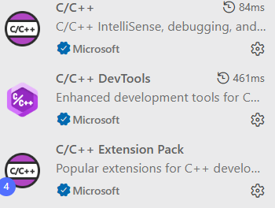

# C
My programs for C testing.

### vscode环境配置

- C/C++
- C/C++ DevTools
- C/C++ Extension Pack

### 文件内容

##### testProgram

- util.h：输出各种数据结构的方法
- test.cpp：测试基础代码、STL数据结构
- Basic：对数组、结构体、链表、树的测试
- Search：测试搜索算法
- Sort：测试排序算法
- ObjectStruct：自定义类
- LeetCode：LeetCode代码测试
